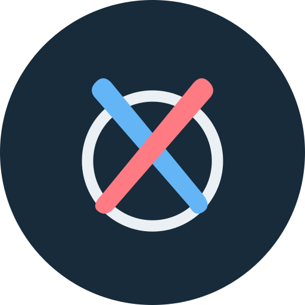
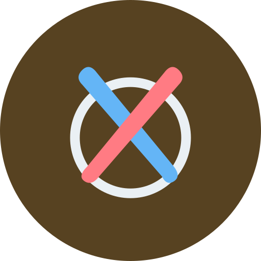

# Launcher icon

The maintainer selected **A: crossed sticks over a snare-head rim**. It is wired
as the app icon, with a distinct beta background. All artwork is original
geometric vector art under the app's GPL-3.0-only license; no font or external
artwork is used. The rim is drawn as concentric circular paths with an even-odd
fill; the blue/red sticks use tapered polygons and rounded quadratic curves.

| Variant | Idea | Stable | Beta |
| --- | --- | --- | --- |
| A | Crossed blue/red sticks over a snare-head rim |  |  |

The `variants/a/` directory retains a 108 dp Android vector foreground, a white
monochrome vector and stable/beta background drawables. Foreground artwork fits
inside the central 66 dp safe circle (radius 33 about 54,54). Stable backgrounds
are slate blue; beta backgrounds are warm brown. Beta changes only the background;
Android's themed icons deliberately use the same monochrome silhouette.

## Reproduce previews

Run `bash scripts/render-icon-variants.sh` with `rsvg-convert` (librsvg) installed.
It translates the Android paths directly to SVG, preserving even-odd fills, and
produces four 512×512 PNGs: full-bleed and circle-masked stable/beta previews
of the selected icon. These show the entire 108 dp layer; a real launcher's viewport,
mask and motion can change the apparent scale. They are artwork previews, not
store screenshots or an Android launcher capture.

## App resources

The retained `foreground.xml`, `monochrome.xml`, and `background.xml` match
`app/src/main/res/drawable/ic_launcher_{foreground,monochrome,background}.xml`
respectively. `beta-background.xml` matches
`app/src/beta/res/drawable/ic_launcher_background.xml`. Keep these documentation
sources in sync when editing the app resources. The shared adaptive icon
references all three layers; beta overrides only the background. Rejected
variants B, C and D have been removed.
